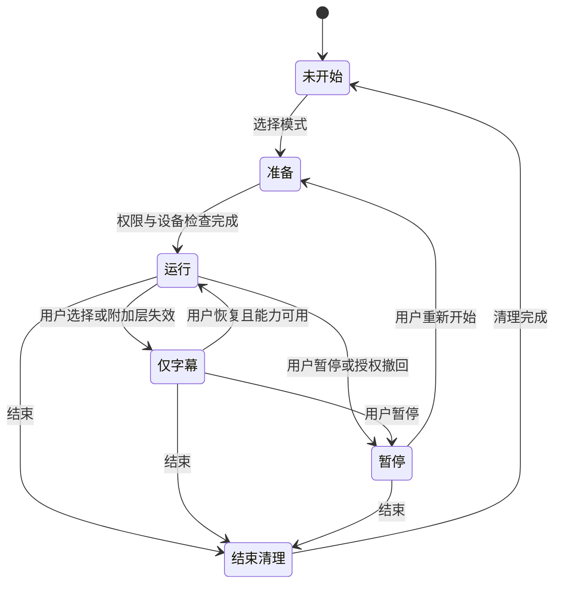

# 使用场景与功能规格

## 1. 首版完整操作链

### 开始前

用户从手机正常入口选择“会话字幕”，看到当前设备、数据输入、上传设置、眼镜连接和文字样例。可调字号、对比度、位置和补充线索开关。以可访问方式向对话伙伴说明本次采集与处理；研究场景另外执行批准的同意程序。

初始功能只开启完成当前任务需要的输入。相机、健康数据、动作分析、云模型和长期保存都有独立状态，不随字幕开关暗中启动。没有眼镜时明确进入手机预览或研究回放，避免将模拟画面当作实机效果。

### 对话中

主区域保留字幕和匿名发言人标签。补充信息放在固定的有限槽位；不确定、过期、无法关联的内容按策略留空。用户可随时切回“仅字幕”、固定位置、暂停所有采集或只关闭辅助提示。

手表 / 已核实的腕带动作 / 手机触控只是不同控制入口，必须产生同一种有来源的 `UserAction`。命令手势与被动动作观察分开，避免系统把日常小动作直接执行为控制命令。涉及保存、上传或开始采集的操作需要可感知的状态回执。

### 结束后

停止采集、取消未完成模型请求、停止输出并清理会话缓存。默认只显示本次连接和质量概览，不自动生成带他人信息的长期摘要。保存、导出或研究留存各有明确范围；用户可查到是否有外部服务曾接收资料及其处理限制。

## 2. 代表性情境

| 情境 | 用户目标 | 期望行为 | 失败恢复 |
|---|---|---|---|
| 两人讨论项目 | 读到内容并保持看向对方 | 稳定字幕、清晰标签、少量按需线索 | 不确定词保留标记，允许请求重述 |
| 三人轮流讲话 | 知道一句话由谁说出 | A/B/C 保持会话内一致，方向仅在可证实时显示 | 关联丢失用“发言人未知”；不硬选一个人 |
| 多人重叠 | 发现理解可能受阻 | 简洁“多人同时讲话”提示，不伪造完整分离 | 保留可确定片段，允许回看最近内容 |
| 用户觉得信息太多 | 降低额外干扰 | 一步进入仅字幕，保留手动恢复 | 不自动反复把已关闭功能打开 |
| 用户希望自我觉察 | 得到本人选择的低干扰支持 | 依照自述与可用数据询问是否需要帮助 | 可以标注“正常活动 / 有帮助的小动作 / 不需要” |
| 网络或模型不可用 | 继续基本会话 | 关闭语义附加层；已有本地字幕能力继续 | 界面明确当前可用功能，不伪装实时 |

## 3. 状态机

“暂停提示”与“暂停采集”使用不同标签，不能让用户误以为所有数据采集已经停止。平台无法实际停止某一路时应报告状态，并阻止进入声称已暂停的界面。

## 4. 无障碍与输入

提供高对比度文字、字号和固定位置调整、非颜色单一编码、触控替代手势、可读的连接状态和短句说明。对手部运动受限、不会使用特定手势或使用手语的参与者，所有关键功能均应有其他输入方式。手语动作不视作异常或负面情绪信号。

眼镜的可显示区域、字体、提示回执和可用输入受实际 SDK 限制；没有已验证触觉接口时，不能画出“腕带已震动”的成功状态。能力不足时使用手机或手表的可用反馈，记录设备差异。

## 5. 需要观察的交互结果

除读懂内容外，还要记录：眼镜和手机之间的切换、主动关闭次数及原因、提示是否盖住重要内容、理解错误时如何恢复、是否感觉系统代替本人判断、对话伙伴是否改变说话方式。头向只能作为头向指标，不能未经验证叫作眼动、注意或眼神接触。

具体研究方法见[首年协议](../05-实验与评估/首年研究协议.md)。

[返回交互设计](README.md)
