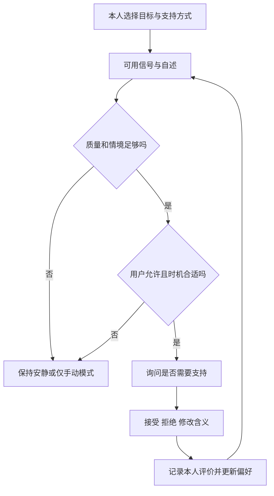

# 日常觉察与自我调节

## 1. 功能定位

目标是帮助佩戴者留意自己认为有意义的变化，并决定是否需要支持。心率、手部动作、活动背景和本人感受可以相互补充；某种肌肉活动“可以被读到”并不意味着它代表紧张、愤怒或用户没有意识到的意图。

需分别回答三个问题：**能否识别一个动作模式？该模式对这个人在此时有什么意义？在这个时刻提供支持是否有帮助？** 第一个问题的高准确率不能替代后两个问题。相关证据与边界见[生理与微动作探索协议](../05-实验与评估/生理与微动作探索协议.md)和[参考文献](../07-文献与证据/参考文献.md)。

## 2. 信号分工

| 输入 | 可以用于什么 | 主要限制 |
|---|---|---|
| Apple Watch 心率 | 相对本人基线的变化、恢复趋势、数据是否新鲜 | 采样与送达不等价；运动、姿态、药物、睡眠等均可能影响 |
| 可用 HRV | 按明确来源与窗口辅助描述变化 | 不是逐秒情绪；缺少可靠逐搏数据时不得由稀疏 BPM 重建 |
| 手腕运动 / 活动 | 判断打字、走动、搬物等混杂背景 | 模型可误判；也可能与生理伪影同源 |
| 腕部 sEMG | 在可访问原始信号时研究本人选定的手部肌肉模式 | 消费级手势事件不是原始肌电；佩戴、汗液、位移和日间差异需测试 |
| 消费级腕带手势事件 | 用作确认、关闭或请求支持的命令候选 | 识别事件不证明有意操作，需误触保护；不能代替被动习惯识别数据 |
| 用户自述 | 当时是否注意到动作、是否有帮助、是否想要支持 | 主观但必要；不能被传感器结果自动覆盖 |

手表与肌电腕带通常是不同采集端；同时佩戴的左右腕位置、舒适度和传感干扰均需记录。官方平台证据见[硬件目录](../04-硬件与平台/README.md)。

## 3. 个人校准

初期只选 1–2 种本人希望理解的动作，例如某种握紧 / 放松或手指重复活动。由参与者命名“动作 A”，不由开发者预设成“焦虑动作”。收集自选动作及普通活动负例：使用键盘、拿杯子、手语、携物、调整眼镜、触控和静息。

跨日测试必须与训练日分开；重戴设备、活动增加或信号质量降低时允许退回“无法判断”。标注分开保存动作事实、本人当时感受、是否自觉、是否希望被打断。仅当参与者自述“刚才没注意”时，才记录为本人未注意到的动作。

## 4. 支持闭环

可选支持是用户事先选择的低负担动作：减少补充线索、暂时固定字幕布局、短暂停顿、个人觉得舒服的放松练习、会后反思或完全不提示。不得让模型自行给出新的呼吸强度、治疗建议或诊断。

拒绝后进入冷却；“今天不要再提醒”立即生效。系统不因连续检测到同一动作就不断提醒。初始提示预算见[项目章程](../00-项目总览/项目章程.md)，试点后冻结；手动请求始终可用，并与自动提示分别计量。

## 5. 对话模式与日常模式

**后续对话模式扩展**可研究在用户选择下用本人状态调节附加信息密度，不能隐藏其仍需要的核心字幕。这不是首年 C0/C1/C2 的实验输入；核心 C2 只使用已冻结的候选不确定性和显示负担策略。生理支路延迟或故障不得阻塞字幕，模型不能以“你可能紧张”为由自动替用户发送回复。

**日常模式**只使用选定的腕部 / 手机信号和手动标记，默认关闭外部麦克风与相机。可在一次明确开启的时间段里观察模式，在方便时提供反思；无需持续监控别人，也不要求戴着眼镜才能使用所有手动功能。具体可持续时长取决于真实平台后台与电池测试。

**会后模式**可以显示本人选择保存的概览，例如“你标记过两次需要暂停”，同时附数据缺口。它不生成全天“情绪成绩”，不把小动作减少当作表现进步。

## 6. 研究比较与停止条件

信号接入与伦理条件满足后，拟以 8–12 名参与者、约两周的独立可行性试点，探索手动支持、HR+活动/上下文、再加个人动作模式的增量版本；不把该规模作为比较优效或临床疗效检验。界面、可用支持、提示上限尽量保持一致；随机时点和触发时点都邀请少量自述，防止只学习模型已认定为“值得问”的样本。

报告无效提示 / 小时、参与者认为有用的支持比例、干扰、缺失、实际佩戴时间和本人选择的结果。若加入肌电并未改善这些结果，产品保留手动或简单生理版本。出现持续不适、不愿继续或过度关注自身信号时，优先暂停自动提示并重新讨论需求；这一安排不作诊断。

[返回交互设计](README.md)
