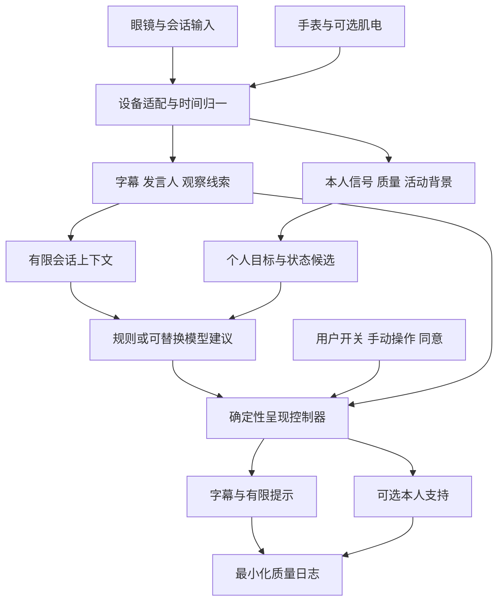

# 系统架构与模块边界

## 1. 总体结构

手机承担会话控制、能力协商和呈现策略的协调角色。眼镜负责已开放的采集 / 显示 / 输入，Apple Watch 提供获准的本人数据和反馈；研究级肌电是可拔插支路。桌面算力可支持研究回放与离线分析，云模型按单独授权接收最小必要的结构化内容。

字幕直达控制器，不等待模型或生理支路。外部对话与本人状态的数据虽然可对齐，但保留独立来源与可见性；默认不会把健康信息展示给对话伙伴。

## 2. 模块所有权

| 模块 | 输入 / 输出 | 负责 | 不负责 |
|---|---|---|---|
| DeviceAdapter | 平台事件 → 统一事件 / 能力状态 | SDK、权限、连接、流质量和时钟信息 | 不推断情绪，不捏造缺失传感器 |
| SessionController | 用户操作 → 会话生命周期 | 模式、授权、停止、清理、会话 ID | 不让模型启动采集 |
| CaptionPipeline | 音频 / 回放 → Utterance | 增量转写、修订和质量 | 不把解释写进原始字幕 |
| SpeakerAssociation | 分段 / 临时轨迹 → SpeakerTrack | 匿名关联与未知状态 | 不做永久身份档案 |
| CueExtractor | 转写 / 有效特征 → CueCandidate | 观察事实、有限标签和证据引用 | 不替用户定义内心 |
| SelfAwarenessPipeline | 生理 / 活动 / 动作 / 自述 → 本人候选 | 个体基线、混杂、缺失、支持需求候选 | 不诊断，不以手势类别等同感受 |
| ContextStore | 事件与修订 → 有限结构化上下文 | TTL、实体、去重、失效传播 | 不默认长期记忆 |
| DecisionProvider | 结构化上下文 → 允许动作建议 | 规则、经批准的本地模型或 Jev 适配 | 不绕过最终策略、直接调用设备或发消息 |
| PresentationController | 建议 + 用户策略 → 实际呈现 | 权限、时效、字幕优先、预算、退出 | 不把低置信候选隐藏成事实 |
| Renderer / FeedbackAdapter | 呈现命令 → 可观察回执 | 设备可用显示 / 反馈 | 不自行新增模型推断 |
| ResearchRecorder | 获准事件 → 受控研究资料 | 条件、版本、观察和缺失记录 | 不默认记录原始音视频或改变实验条件 |

## 3. 能力协商

连接时报告真实 `DeviceCapabilities`：型号、OS、SDK / 固件、权限、显示模式、音频路由、视频来源、位置坐标系、手势事件、原始肌电、健康指标及其来源、反馈方式和后台限制。

每项能力至少区分 `supported`、`permission_granted`、`verified_on_device`、`fresh_data_available`。文档支持不等于当前账号已获准，获准不等于当前佩戴正常。没有验证的能力保持 unknown；禁止因收到一个点击事件就把 raw_emg 标记为 available。

设备参数和版本锁定到实验 manifest。中途升级固件 / OS / SDK 需要记录，并判断数据质量或界面是否改变，不把升级前后数据无条件合并。

## 4. 计算放置

- 首版界面与回放优先在研究电脑 / 手机打通；回放屏幕明确显示来源与模式。
- 可行时将字幕基础处理与策略留在手机；具体 ASR 端侧实现需按准确率、热量、许可与延迟试测后选择。
- 云调用只接收已允许的文本 / 结构化特征，并有开关、成本上限和超时。云不可用时保留已验证本地路径；若本地 ASR 本身未实现，应明确字幕不可用，而非承诺无条件离线工作。
- Jev 不承担未经证实的原始音视频处理。眼镜或手表上的大型模型部署不属于首年必需条件。
- Celestial 主机可在以后提供可用算力，不能接管手机的同意状态、传感器权限或即时停止权。

候选技术与许可证见[复用与选型](../06-开发计划/复用与选型.md)，未选型部分不用虚构依赖锁文件。

## 5. 两种动作通道

`CommandGesture` 是面向显式控制通道的候选命令事件，仍可能误触，不能证明用户有意识地发出了该命令；`MotorEvent` 是研究管线检测到的身体活动候选。二者采用不同类型、权限和用途。被动动作识别不得直接开启上传、保存、发言或删除，尤其不能将日常小动作识别结果当作确认手势。保存、上传等改变数据使用范围的操作须另有明确确认。

控制命令提供去抖、短时重复抑制和可观察回执。日常动作模型的适用性通过跨日和普通活动负例验证，不将跨用户通用手势模型的结果直接等同于个人习惯。

## 6. 降级规则

| 故障 / 缺口 | 降级行为 | 记录 |
|---|---|---|
| 相机不可用或关闭 | 音频字幕 / 会话内标签；不显示未经证实的位置 | 缺失模态与原因 |
| 发言人关联不足 | 标签未知 / 多人，不猜测人物 | 关联质量与持续时间 |
| Jev 超时、格式错误或关闭 | 规则后端或仅字幕；旧建议过期 | 错误类型、后端、耗时，不记录敏感请求正文 |
| HR / EMG 过期 | 暂停自动状态提示，保留手动模式 | 最后观察、送达时间和拒绝原因 |
| 眼镜断开 | 手机明确提示并按可用能力继续 | 实际呈现设备，研究条件偏离 |
| 存储或清理失败 | 不声称已删除；停止增加该路径数据并报告 | 具体存储范围和处理状态 |
| 云授权撤回 | 停止新请求，取消可取消的请求并处理已发数据限制 | 撤回时间、在途请求状态 |

## 7. 性能预算与隔离

分别测量采集、传输、ASR、关联、模型、策略、渲染的时间，报告 P50 / P95 及输入条件。字幕渲染线程不得被模型、同步上传或磁盘写入阻塞。队列有界，过期候选丢弃，紧急停止走高优先级控制通道。

能耗统计眼镜、手机、手表及研究设备总负担，不能仅因眼镜卸载而声称系统省电。研究回放的吞吐率不外推为户外实时性能。

[返回架构导航](README.md)
