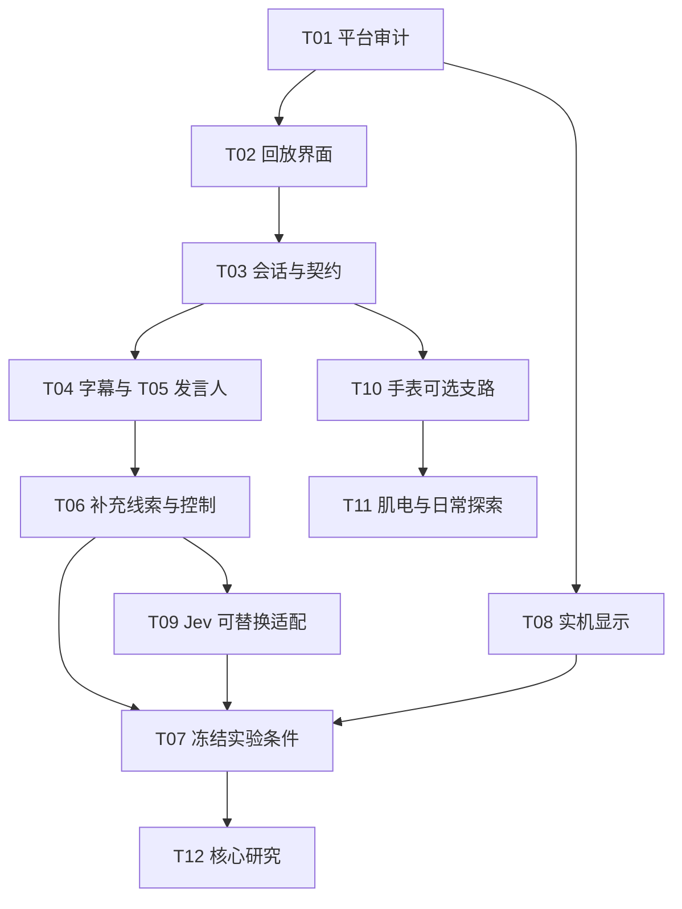

# 里程碑与依赖

计划基线：`CEL-SMART-GLASS-20261022-v1`。M1 表示获准启动后的第一个月，不绑定某个入学日期。招募、伦理和平台访问影响工期，以下是安排依据，不是已确认交付日。

## 1. 一年安排

| 时段 | 研究成果 | 工程成果 | 退出 / 缩减方式 |
|---|---|---|---|
| M1–M2 | 更新文献、社群联系、需求场景、伦理申请和精度规划草案 | 能力审计、合成回放 UI、最小数据契约、来源和暂停 | 无实机先保留标明的回放；不提前采集参与者数据 |
| M3–M4 | 6–8 人共同设计，形成词汇与布局决策 | 逐项字幕 / 发言人 / 提示切片，修订和错误恢复 | 用户不需要某类推断时删除该类别 |
| M5–M6 | 经许可材料、标注、离线校准和数据切分 | 完整回放原型、有限实机接入、规则与 Jev 比较接口 | 低质量推断退回观察性提示或字幕 |
| M7 | 4–6 人试点、修订任务、冻结协议和分析计划 | 冻结构建、显示策略、模型与材料版本 | 关键可用性失败则延后主实验，不不断加功能 |
| M8–M10 | 暂定 24 人主比较；样本量据精度论证调整 | 受控实验运行、故障与偏离记录 | 招募受限则如实降低结论强度，保留可复现材料 |
| M11–M12 | 分析、设计建议、论文初稿、可公开研究产物 | 研究版本归档、必要修复和复现说明 | 不以论文录用 / 商业发布作为一年内必达条件 |

真实对话 6–8 人延伸和日常模块 8–12 人约两周探索均为条件性工作，不能占用核心研究完成所必需的时间。最终人数与招募资源、伦理和精度说明一致，不能把这些数字合并成已承诺总样本。

## 2. 工程依赖

图中的 T09 表示模型适配与比较必须有明确状态，不要求 Jev 一定优于规则；若服务不允许，记录后端选择并冻结可用方案。T08 可依能力矩阵转入受支持头显或明确缩小为屏幕实验；此时不声称消费眼镜部署已验证。

T13 数据生命周期与诊断贯穿 T03–T12，不是研究结束后才补。T14 口译、T15 视觉文字和 T16 外部基础设施在核心版本稳定后分别立项。

## 3. 本项目技术闸门

| 闸门 | 需要证明的事实 | 当前状态 | 失败后的路线 |
|---|---|---|---|
| CSG-G1 显示与访问 | 实际型号和权限允许研究界面；输入、停止和断线恢复可用 | `NOT_RUN` | 替代显示或显著标记模拟 |
| CSG-G2 字幕与来源 | 输入来源、修订、未知发言人和时间链可追溯 | `NOT_RUN` | 受控回放 / 人工标签，并收窄自动化结论 |
| CSG-G3 提示有效性 | 相同候选、时效、校准、控制器和用户开关工作 | `NOT_RUN` | 更简单观察性提示或仅字幕 |
| CSG-G4 手表数据 | 实际型号上获准指标、数据年龄、背景限制和停用可测 | `NOT_RUN / OPTIONAL` | 手动觉察、会后回顾 |
| CSG-G5 连续肌电 | 获准原始流、质量、时钟、佩戴与跨日数据可用 | `NOT_RUN / OPTIONAL` | 只做主动命令，或申请现成研究设备 |
| CSG-G6 研究准备 | 伦理、材料、版本、舒适度、招募与分析计划已就绪 | `NOT_RUN` | 继续非参与者准备；不假设可开始采集 |

这些闸门是任务验收中的事实核对，不新增六轮行政审批。常规实现选择在已有授权和预算内完成；采购、真实数据采集和平台受限能力遵守各自实际权限。

## 4. 最小可交付版本

首年最低研究版本拥有：可控制的字幕层、匿名标签、冻结候选提示、C0/C1/C2、拒绝和退出、可复现材料、透明的错误与缺失记录。它可以在支持研究的设备上完成，且明确结果适用范围。没有高准确率的情绪分类器、全天后台或自制硬件也能回答核心 HCI 问题。

## 5. 后续增长顺序

先验证不同情境下的用户价值，再扩展自动化和规模：真实会话 → 一种新语言 → 翻译共享语义 → 双向 TTS → 视觉文字旁注 → 更长期日常模块 → 经单独验证的空间锚定。更换人群或环境时重新共创与评估，不将首组参与者的数据作为所有人群证明。

[返回开发计划](README.md)
