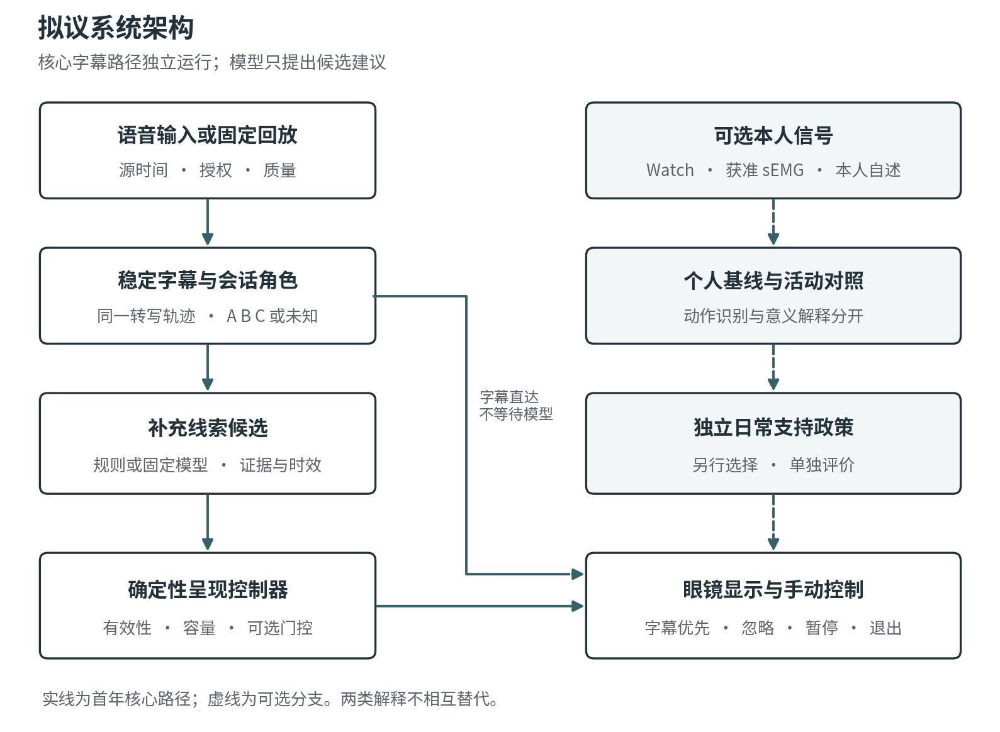
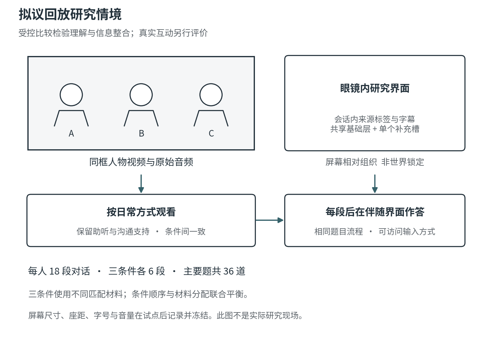

# 面向面对面交流的智能眼镜自适应辅助研究

## 博士申请研究计划与开题讨论方案

申请人：Zhiheng Zhang  
拟讨论导师：李雪亮博士  
拟申请单位：南方科技大学创新创意设计学院  
项目：Celestial Smart Glass  
版本：CSG-PROPOSAL-20261022-v2  
日期：2026 年 10 月 22 日

本研究拟以商业智能眼镜为载体，研究面对面小组交流中辅助信息的呈现时机、解释边界与用户控制。第一年与选择使用字幕的成年聋人及重听者共同设计，构建稳定字幕、会话内发言人标识和少量补充线索，在统一字幕基础上比较不同呈现策略。项目同时保留结合 Apple Watch 心率与可访问腕部肌电的个人觉察研究，以独立的可行性问题分阶段推进。

本计划供博士申请、导师讨论和入学后研究启动使用。计划中的研究均尚未开展；实际设备访问、机构伦理批准、招募合作与最终经费将在启动前落实。研究以可解释的比较结果和可复现的设计过程为交付，不预设实验必然证明系统有效。

## 中文摘要

面对面交流不仅需要理解文字，还需要关联发言人与话语、跟随轮次，并判断哪些表达线索值得注意。智能眼镜可以把字幕放入视野，但有限显示空间也使补充提示与阅读、观察谈话者之间产生竞争。本研究关注一个具体的人机交互问题：在识别和解释存在不确定性时，系统如何决定何时呈现、暂缓或省略辅助线索，同时保留佩戴者自己的判断与控制。

项目拟采用共同设计与受控评估相结合的方法。首先与六至八名选择使用字幕的成年聋人及重听者开展访谈和设计活动，形成线索词汇、空间呈现及退出机制；随后使用商业眼镜、手机和可替换的结构化推理后端，构建能够记录提示来源、时效和抑制原因的研究原型。首年主实验暂按二十四名参与者规划，在相同字幕、发言人标识、布局和候选提示池上，比较仅字幕、按共享有效性与容量规则运行的基础调度辅助、以及额外使用不确定性与显示负担过滤的门控辅助。主要结果是预先指定的低歧义对话解释准确率，次要结果包括主观努力、打断、控制感及错误后的恢复。样本量通过设计阶段精度敏感性分析辅助讨论，不把小样本试点效应当作可靠功效估计。

可选分支研究心率、活动背景和本人选择的手部动作模式能否帮助自我觉察与支持时机选择。该分支将动作识别、个人意义解释和支持是否有用分别验证，不把生理变化解释为确定情绪。预期贡献包括适合有限显示眼镜的辅助设计原则、可审计的呈现策略及其比较证据，以及用户应对错误、忽略提示和恢复控制的交互知识。

关键词：人机交互；智能眼镜；可访问字幕；聋人及重听者；不确定性；用户控制；可穿戴自我觉察

## English Abstract

**Adaptive Conversational Assistance on Smart Glasses with Uncertainty and User Control**

This project investigates when commercial smart glasses should display, defer, or withhold supplementary conversational cues. It focuses on adults who are deaf or hard of hearing and choose to use written captions in small-group spoken conversations. The proposed system combines stable captions, temporary speaker labels, and a limited vocabulary of observable delivery cues and clearly qualified communicative interpretations. Its central contribution is the design and evaluation of a presentation policy that balances informational value, uncertainty, display competition, and user control.

The first year will combine participatory design with a controlled evaluation. Six to eight participants will inform the cue vocabulary, display behavior, and recovery mechanisms. A provisional study of 24 participants will compare captions alone, basic cue scheduling, and gated assistance, while holding the underlying captions, speaker mapping, layout, and candidate pool constant. Both assistance conditions share validity, capacity, scheduling, and user-control rules; gated assistance adds uncertainty and display-load filtering. The primary contrast is gated assistance versus captions alone on prespecified low-ambiguity interpretation items. Secondary outcomes address effort, interruptions, agency, and recovery. Precision sensitivity analysis will inform the recruitment decision before main-study outcomes are inspected.

An optional, separately evaluated extension will examine whether heart-rate and activity information, together with personally selected wrist motor patterns, add value to self-awareness and timely support. Physiological variation will not be treated as a direct label of emotion. Expected contributions are a grounded design space, an auditable research prototype, and evidence about when assistance is useful, distracting, or best withheld. The project will remain feasible if the model provider or device pathway changes, with deployment claims limited to the hardware and conditions actually evaluated.

## 1 研究问题与应用情境

### 1.1 问题定义

我希望研究的核心是辅助信息如何进入正在进行的交流。佩戴者可能一边读字幕，一边观察谈话者、组织回答并管理自己的注意。系统增加一条提示，既可能补充缺失的信息，也可能占据阅读时间、错误引导对话解释或引起额外自我监控。因此，增加信息量与改善沟通不能视为同一件事。

以一个用于设计讨论的假设情境为例：三人在讨论活动时间，A 改口说“不是周四，是周五”，B 紧接着询问是否还需要确认场地。佩戴者可能需要知道更正由谁提出、哪个词被强调、第二句是否需要回应。一个持续给出人物情绪标签的界面未必解决这些问题。更直接的设计可能是稳定显示发言人、保留修正后的内容，并在阅读负担允许时短暂呈现“强调日期”或“可能在提问”。若依据不足，用户仍应得到可读字幕并可以自行判断。此例是材料设计示意，不是访谈发现或系统运行结果。

首年选择二至三人的室内、静坐或站定交流，主要使用一种由招募资源确定的语言。面向的参与者是主动选择字幕作为一种沟通支持的 DHH 成人。研究尊重不同人的听力、语言、手语、助听设备与阅读偏好；不以听人模拟失聪代替目标群体，也不把某一种字幕配置视为全部 DHH 人群的最佳方案。

### 1.2 研究与产品的关系

研究原型承担明确的比较任务：保持字幕基础一致，改变补充信息的呈现政策，并观察理解和使用体验。产品路线则逐步解决实时音频接入、跨设备同步、后台运行、可靠显示和日常使用。两者共享实现，但结论分开记录。回放实验可以支持受控条件下的策略比较，不能直接证明系统能在任意现实对话中持续运行。

长期保留原始智能眼镜构想中的双向口译、视觉文字旁注和短期上下文协同。这些功能只有在新增语言与情境的问题得到验证后才进入后续阶段。首年项目可以独立于 Celestial 其他系统完成；个人项目集成不会成为博士研究的前置依赖。

## 2 研究现状与具体缺口

### 2.1 从字幕可读性到多人话语关联

SpeechBubbles 已通过 DHH 访谈、共同设计与评估研究话语归属、顺序、内容长度和视野外发言人的呈现，说明空间字幕与发言人关联具有明确前史 [HCI-01]。VocalEyes 的近期预印本进一步提出会话内注册与发言人感知字幕，但其控制评估对象为自报典型听力者，不能直接替代目标用户研究 [HCI-06]。本项目将在这些问题基础上考察消费眼镜的有限显示条件、补充线索竞争和恢复机制，研究价值不建立在“首次把字幕放到眼镜上”的主张上。

多人交流也涉及所有参与方怎样协调支持工具。混合听力群体的共同设计研究已指出，技术可能使互动更容易，也可能引入新的负担 [HCI-14]。因此，除了佩戴者的阅读任务，形成性研究还会讨论旁人怎样理解眼镜提示、停顿和暂停动作。但佩戴者对访问方式的选择不会被其他人的便利需求覆盖。

### 2.2 从情感字幕到线索的解释成本

语音韵律和情感字幕研究探索了文字样式对表达信息的承载方式；Caption Royale 系统比较了 DHH 参与者对多种样式的偏好和解释任务，CuCap 则把个性化及文化情境纳入比较 [HCI-03, HCI-09, HCI-04]。这些工作为词汇、形态和个体选择提供基础，也意味着“附加情绪信息”本身不足以构成新颖性。

已有研究在表达信息获取和视频叙事参与等方面报告了补充字幕或视触觉线索的收益，为进一步研究其在会话中的价值提供了依据；不同任务与通道的结果也提示需要重新检验收益及成本 [HCI-03, HCI-10]。本项目因此同时保留“有用的信息怎样更容易取得”和“何时省略更好”两个设计方向。

Fuzzy Feelings 展示了唤醒度反馈可能被理解为响度等不同概念，并探索更直接的声学触觉映射 [HCI-05]。这一结果支持本项目将可观察声学变化与语用解释分开，而不是假定用户共享统一的情绪编码。已有媒体字幕或触觉研究的效应也不能直接用作消费眼镜面对面交流的预期效果量。

### 2.3 不确定性需要转化为交互决定

关于不完美 ASR 的 DHH 研究表明，人们对置信度信息的期待和实际使用偏好可能不同 [HCI-02]。人机协作设计指南进一步强调说明系统能力、在不确定时限定行为、允许忽略或纠正，以及支持全局控制 [HCI-08]。因此，本项目不把显示一个概率数字视为充分解决方案，而是研究证据、时效、显示占用与个人设置共同作用后，哪些提示值得出现。

候选线索的判断与最终显示是两个层次。一个分类器可能对某个标签有很高输出分数，但这条信息已经过时、属于未知发言人，或会挤占正在修订的字幕。此时不呈现可能比呈现更合适。上述因果逻辑构成待验证的呈现政策，而不是对有效性的预先结论。

### 2.4 穿戴伙伴与个人意义

李雪亮及合作者的 Grippy 以穿戴装置和手机应用研究人与可穿戴系统的压力应对关系；其探索性现场研究也记录了误报、动作干扰和设计意图与实际使用之间的不一致 [LI-05]。近期 MindSeed 将 fidgeting 数据用于个人反思，提供了“数据如何由用户赋予意义”的方法连接 [LI-04]。本项目将这一连接用于可选的个人觉察分支，研究本人是否需要提示、如何解释提示和何时拒绝它。

生理数据的加入需要独立证明增量价值。大规模自然情境研究发现 HRV 与自报压力的对应关系有限；Apple Watch 主动 ECG 的研究也不等于被动手腕 PPG 的连续情绪识别验证 [HRV-01, HRV-02]。因此，首年沟通研究不会依赖“能够读出情绪”这一假设。

### 2.5 本项目拟填补的缺口

本项目将研究焦点放在有限显示空间中辅助信息的选择、时机与可恢复性。与近邻工作的差异体现在三个可检验层面：第一，目标用户提出的接受与拒绝边界能否转成具体、可追溯的呈现规则；第二，在相同字幕及候选池下，完整门控政策是否带来可测的解释收益或负担变化；第三，错误归属、失效提示和不同解释发生后，什么操作能使用户继续掌握交流。详细近邻比较和检索边界随文献综述附件保留，持续更新而不宣称穷尽全部相关工作。

## 3 概念框架与研究问题

### 3.1 信息价值与参与者控制

研究框架将辅助视为一项可拒绝的资源。系统感知到信号后，先形成候选观察或解释，再根据可用证据和当前界面决定是否呈现，用户随后可以使用、忽略、修改设置或暂停。评价应覆盖这整个过程：识别正确但时机不合适的提示，仍可能是不良交互。

研究通过设计（Research through Design）用于产生并比较具体交互方案、记录取舍和反例；受控实验用于估计冻结政策的条件差异。这两类证据互补：设计案例提供情境化的解释与可迁移原则，受控比较提供特定参与者、材料和设备范围内的效应估计 [METHOD-02, METHOD-03]。不会把小样本共同设计等同于普遍定律，也不会只凭一个平均分数否定少数人的不同需求。

| 层次 | 本项目中的含义 | 证据或测量方式 |
| --- | --- | --- |
| 可观察事件 | 发言时间、重叠、语速或强调变化 | 经同步的音频、转写与独立标注 |
| 沟通解释 | 有限、可质疑的假设，例如可能需要回应的问句 | 明确情境、标注一致性与任务表现 |
| 提示政策 | 在特定时刻呈现、暂缓、弃权或不操作 | 可重放的规则、候选池与决策日志 |
| 用户体验 | 理解、努力、被打断感、解释自主权 | 任务结果、自评、行为记录与访谈 |
| 本人觉察 | 生理与动作变化和本人解释之间的联系 | 个人基线、活动对照、当时或回顾自述 |

### 3.2 研究问题

**RQ1 用户需求与设计边界。** 选择使用字幕的 DHH 成人希望在何种情境下获取何种补充线索？哪些表示、时机和操作会被视为有帮助、分心或越界？

**RQ2 呈现政策的净效应。** 相较仅字幕，门控后的辅助是否改善预先指定的低歧义对话解释？相较共享有效性、容量和调度约束的基础辅助，增加不确定性与显示负担过滤如何影响努力、打断和辅助的使用？

**RQ3 错误后的解释与恢复。** 当提示可能错误、归属不明或与本人理解冲突时，用户怎样察觉、忽略和纠正它？什么界面行为支持继续交流和恢复控制？

**RQ4 可选的本人状态觉察。** 在用户选定的日常情境中，心率与活动信息加入个人手部动作模式后，是否比手动记录或较简单的生理基线提供更有用的支持时机？增加的传感、校准和提示负担是否值得？

### 3.3 假设与可反驳结果

H1 预计 C2 门控辅助相较 C0 仅字幕可提高预先指定的解释准确率。检验采用双侧推断，报告准确率差及区间；若效果很小、方向相反或区间过宽，将按实际证据解释。

H2 预计 C2 相较 C1 基础调度辅助可降低主观努力或打断。这是用于设计与描述性评价的次要预期，本轮不把体验指标设置为另一组确认性显著性检验。不能用“提示条数变少”直接替代用户负担下降，也不能通过未显著的理解差异宣称非劣效。用户控制与恢复方式主要通过独立探针及质性材料解释。

若 C0 表现相当或更好、用户主动关闭大多数线索，研究将界定哪些类别和情境没有增量价值。若 C2 的收益主要来自降低提示密度，则后续加入密度匹配对照；首年结果只解释完整政策的净效应。若个人觉察增加负担或肌电没有增量价值，则保留手动支持或较简单的数据路径。

## 4 系统与交互方案

### 4.1 设备与计算分工

优先研究设备为 Meta Ray-Ban Display 与手机。普通无显示 Ray-Ban Meta 可以承担部分采集或音频功能，但不能独立显示视野字幕。Meta 的 Device Access Toolkit 已公开描述面向兼容显示设备的移动应用集成；具体输入、音频、运动与分发条件仍须按固定 SDK 和实际账户核实 [META-01, META-02]。第一年使用商业硬件，不以自制光学、PCB 或训练新的基础模型为必要任务。

手机负责会话管理、权限、时间对齐、呈现政策与数据最小化。语音识别和说话者分离可以先运行在实验室计算机上，待实测再迁移合适组件。核心回放实验使用冻结事件轨迹，从而在识别质量一致时比较界面政策。实时扩展需要另行证明采集、处理与显示能稳定串联。

Apple Watch 是本人健康数据和反馈的可选端，通过 Watch 应用、配对 iPhone 与眼镜伴随应用协同。Meta Neural Band 的手势控制与研究级原始肌电接入作为不同能力处理。两者都不构成核心字幕实验的必需设备 [APPLE-03, META-03, META-04]。

### 4.2 自适应空间字幕

首版空间呈现采用屏幕相对的稳定区域，搭配会话内 A、B、C 标识和必要的方向或区域提示。这里的“空间”表示字幕与会话角色、视野区域之间的组织关系，不预设世界锁定三维锚点、眼动追踪或可访问的多通道原始麦克风阵列。真实设备提供更丰富能力时，再增加独立验证。

字幕以增量形式出现，已经稳定的文本尽量保持位置，只在尾部更新未稳定部分。长句按可读单元折行，用户可调整字号和是否保留最近话语。说话者映射证据不足时显示“未知”，重叠讲话具有单独状态；系统不会为了保持连续标签而猜测人物身份。

共同设计阶段比较两至三种布局，例如固定字幕区与有限角色分区。主实验冻结一种布局及其自适应规则，三条件完全共享。因此该实验的差异不被解释为某种空间布局独立优于另一种布局。

### 4.3 补充线索与手动通道

线索优先从可以说明来源的范围开始：重叠讲话、明确的语速或强调变化，以及经材料验证的有限沟通行为假设。观察与解释使用不同表达，例如“重叠讲话”和“可能在提问”；界面不提供愤怒、撒谎、喜欢我等断言。具体类别与词汇须由共创、语料标注和试点决定，而不是由模型能输出什么决定。

字幕始终优先，补充线索同时最多占一个活动槽。用户可暂停辅助、切换仅字幕、隐藏单类提示、撤销误操作并结束会话。消费腕带上的显式控制手势也可能误触，需反馈和撤销；本人被动动作模式不得直接触发同一套命令。提示出现与用户看见、理解之间也保持区分，应用回执不被冒称为注意或理解的测量。

### 4.4 分层数据流

系统把原始转写、声学观察、候选解释、本人状态和最终输出分成不同事件类型。数据事件保存来源、原始观察时间、窗口范围、处理时间、质量、有效期与版本。外部对话与本人信号的解释保持独立：本人心率上升不能成为“对方有敌意”的证据。

运行时尽量在设备端提取必要特征，保留最小短期上下文。最长九十秒滚动缓存只是初始上限，不是必须存满的目标，更不是研究数据保存期限。云端后端只有在机构认可处理安排和参与者同意后才能接收允许的数据；文本摘要和特征也按可能敏感的数据管理。

## 5 自适应政策与模型方法

### 5.1 政策的输入与动作

候选提示进入政策前必须具备类型、相关话语或发言人、时间范围和可检查的证据。硬性检查处理权限、身份关联、过期、数据质量和用户设置。只有通过这些条件的候选才进入可选门控；研究中的 C1 和 C2 都执行硬性检查。

可选门控结合独立评估的可靠性、字幕修订状态、显示占用、当前活动提示和类别偏好。显示占用是工程代理量，不被当作认知负荷的直接测量。策略选择呈现、暂缓、弃权或不操作；暂缓不延长原始有效期，过时后直接丢弃。短时间内相同线索合并，使用稳定窗口或滞回避免反复闪现，具体参数经试点冻结。

政策目标是在满足可读性、时效和用户控制约束下，保留具有足够信息价值的候选。首版采用可解释规则，不要求拟合一个不可验证的“社会效用”数值。若使用分数或代价函数，权重、阈值、标签定义和调参材料都作为实验配置保存；测试材料不能参与调参。

### 5.2 Jev 的作用与可替换性

本计划中的 Jev 指 TypeSafe AI 的结构化判断模型。它接受文本或结构化文本，不承担原始音视频的感知；核心也不依赖实验性的图像功能 [JEV-01, JEV-03]。模型可以根据已提取事件，对限定问题给出候选类别或允许动作建议，再由确定性控制器决定是否显示。它不能更改原始转写、调用新的传感器或覆盖用户关闭设置。

固定的问题表应让输出范围可检查，例如“当前证据是否足够支持该类别”“候选是否仍与当前话语相关”。模型的 confidence 不是本研究任务中天然校准的正确概率 [JEV-02]。若标签本身不具可靠定义，不能用校准技术把它包装成确定事实。可标注类别采用保留说话者和会话的校准与测试划分，报告每类覆盖率、选择性错误风险及误拒绝。

对照包括规则后端、可行的简单分类器与固定版本 Jev。后端比较首先评估可用性、错误分布、延迟和数据成本；最终 HCI 实验使用冻结候选池，不在不同条件间重新生成输出。若 Jev 不具增量价值或处理安排不适合参与者数据，使用规则或获批替代模型仍可回答原来的交互问题。

### 5.3 技术评估与可解释失败

离线评估将语音转写、说话者分离、人物关联和线索分类分开。转写按目标语言报告词错误率或字符错误率；发言时间分离不等于已正确知道现实中的人物；提示准确性要同时考虑内容、归属和时效。模型错误、身份错误与显示故障具有不同日志和恢复路径。

延迟分解为采集、转写、特征处理、模型、传输和显示，报告中位数、较高分位数与掉帧或丢事件比例。信号年龄从观察时间或特征窗口末端计算，不能用“刚收到”替代“刚测得”。实验室回放结果和现场端到端结果分别报告。详细算法、数据契约和平台验证步骤见实施附件。

## 6 首年研究程序

### 6.1 阶段一 需求访谈与共同设计

伦理批准后，拟邀请六至八名成年 DHH 参与者，覆盖不同的字幕使用习惯、阅读偏好和小组交流经验。招募以自我认同与愿意使用字幕为准，不要求披露临床听力诊断。筛选应确认能在所选主要语言中理解研究材料，并提供书面、手语或其他适合的沟通支持。每次访谈及设计活动采用可以休息、分次和远程参与的安排，补偿不会以完成全部任务为条件。

访谈首先了解最近的具体交流片段，再使用情境卡讨论错误发言人、长字幕、难以解释的语气、过时提示和主动关闭。参与者比较两至三种低保真布局与线索表示，解释选择理由，也可提出完全不需要某类辅助。研究保留分歧、反例和被放弃方案，不以少数人的多数票覆盖个体访问需要。

分析产出包括情境与需求主题、线索的接受或拒绝边界、可操作的设计要求，以及每项要求对应的访谈或设计证据。可邀请愿意参加的对话伙伴提供另一侧视角，但这部分单独标记；佩戴者对访问支持和本人数据的选择具有优先性。共同设计的目标是形成可检验原型，不承诺六至八人足以代表所有 DHH 用户或达到理论饱和。

### 6.2 阶段二 语料与离线评估

研究材料使用经明确授权的原创录制或符合再使用条件的素材。主要语言、说话人数、场景、脚本、录音条件和许可进入材料清单。材料由二至三人进行低风险的日常讨论，例如时间协调、任务分工或出行安排，避免个人关系冲突和高风险判断。

参考转写与脚本用于建立内容事实，独立标注用于检查强调、问句和重叠等事件，参与者的解释则是研究结果。三者相互区分，模型输出不作为自身正确性的标准。至少两名经过训练的标注者先独立标注，再记录分歧及协商过程；一致性不足的项目进入歧义材料集，不纳入主要准确率题库。

主实验呈现使用同一版本的 ASR 轨迹冻结回放。人工校订只用于参考转写与标签，不在某个条件中暗中改善展示文本。候选池在冻结材料上提前生成，保留源事件、模型与阈值版本。训练、校准和测试按说话者及会话划分，避免同一人的相邻片段跨集合造成泄漏。低资源时可先完成规则后端，保留相同事件契约。

离线研究报告每类错误和拒绝，包括模型判错、未知发言人、过期、质量不足和显示限制。覆盖率与被显示子集的错误率一起呈现，防止仅展示极少数简单案例而得到虚高准确性。该评估说明系统如何选择信息，不能单独回答用户是否从中受益。

### 6.3 阶段三 试点与协议冻结

四至六人的试点检查材料是否可理解、题目是否出现天花板或地板效应、操作是否易学，以及眼镜舒适度与会话长度。试点参与者不纳入正式主实验分析。修改依据是任务与流程可用性，不能根据哪个条件赢得更多来选择题目或反复调策略。

正式研究前冻结：材料及顺序表、候选池、提示政策、字幕布局、设备与软件版本、主要结果、次要比较、排除和缺失规则、停止招募规则。主实验开始后新增分析明确列为探索；无法避免的协议偏离说明时间、理由、影响和是否在查看结果前作出。

### 6.4 阶段四 受控策略比较

主实验暂以随机分配二十四名 DHH 成人为初期规划规模，采用被试内设计；不通过事后替换退出者凑成二十四名完整完成者。准备十八段四十五至六十秒的预录对话，每段对应两道预先指定的主要题，共三十六题。材料分成 A、B、C 三组，每组六段、十二题，其中两人和三人对话各三段。每位参与者在一个条件中观看一个材料组，不重复观看同一段素材。六种条件顺序及材料分配联合平衡，使材料、条件和时期的影响能够区分。

参与者坐在一块前方显示屏前，观看两至三名谈话者同框出现的预录视频；字幕和补充线索呈现在所佩戴眼镜的稳定区域内。保留视频原有音频与画面，并允许使用本人惯常助听设备及其他正常访问支持，音量调至舒适后在条件间保持一致。片段结束后在配套设备上回答两题，可提供等效的无障碍输入方式，不在谈话播放时同时叠加作答面板。屏幕尺寸、观看距离、字体、音量、休息与操作安排将在试点后记录并冻结。

该任务主要测量观看对话时的信息整合，参与者不需要扮演视频中的谈话者。因此主实验不能单独回答自由交流中的轮次抢占、即时回答或双方互动是否改善；这些问题属于后续真实会话研究。

| 条件 | 共享的基础 | 补充线索政策 |
| --- | --- | --- |
| C0 仅字幕 | 相同 ASR 轨迹、发言人标识、布局、自适应规则和时序 | 不展示补充线索 |
| C1 基础调度辅助 | 与 C0 相同 | 在共享有效性、容量和基础调度约束下呈现候选，不使用额外的不确定性与显示负担过滤 |
| C2 门控辅助 | 与 C0 相同 | 同一候选池再经不确定性与显示负担门控 |

三条件保持正常访问支持与用户暂停能力。C1 与 C2 共享权限、身份、时效、退出、基本显示容量，以及排队、冲突、替换、去重和初始个人设置；不会为了制造差异而让 C1 展示故意过期或不合规信息。容量限制下的候选不保证全部实际出现。用户主动关闭的类别不在切换条件时自动重开，关闭事件保留在按分配策略的分析中。候选在条件间不重新生成，设备故障与策略有意省略分开记录。参与者被告知辅助可能不准确，但不会在任务中收到暗示某个条件更好的说明。

主要题考察对话整合，例如结合修正和后续确认判断最终安排、识别明确问题的回应对象，而不只是抄写提示。答案基于完整材料与独立标注确定，所有条件均有相同基础材料。强调或对比、明确问句功能、重叠或修正后的内容三类题保持平衡。主要准确率采用预定评分键，不把“更像研究者的情绪解释”当成正确答案。

例如拟录材料 S4 中，乙把活动从周四改到周五下午，丙确认地点为二楼小会议室，并说明自己周五上午只是送桌牌。随后乙答应在午饭前确认能否借到投影仪。界面候选仅包括“强调”“可能在请求确认”“重叠发言”，不包含最终安排的答案。S4-Q1 询问最终活动时间与地点，正确答案为“周五下午、二楼小会议室”；S4-Q2 询问乙尚待确认的对象与反馈时间，正确答案为“投影仪能否借到、午饭前反馈”。两题都要求结合完整话语，不能通过抄写辅助标签完成。完整拟录脚本、选项、时间轴及评分依据见实施附件；这些是待试点材料，不是已经采集的对话或 ASR 成果。

预计单次研究约八十至九十分钟，包含说明、练习、三个条件区块、休息、问卷、恢复探针和访谈。若试点显示疲劳或访问需求使该安排不合适，可在冻结前分成两次。每个条件结束后记录努力、视觉不适、打断与控制感。所有参与者均可随时休息、跳过或终止，不以完成速度评价其沟通能力。

### 6.5 阶段五 恢复探针与可选真实交流

主任务完成后，另设六个低风险恢复探针：两个正确候选、两个可恢复的语义错误候选，以及两个应被合法抑制的过期或归属不明候选。每类的两个匹配版本分别分配至 C1 与 C2，并在参与者间交换、平衡顺序。分配平衡不等于强制曝光；C2 可以按既定规则抑制正确或错误候选，共同保护不为探针关闭。

探针不进入主要准确率题库。逐例记录分配、实际显示、报告注意到、解释与恢复操作，并在事后询问其依据和希望保留的控制。每人六例不足以估计泛化识错率或证明某策略更安全；实际被看到的错误子集也受选择影响。合法抑制、真实错误与合理的解释分歧分开讨论，不把未知状态统一判作模型失败。

若设备访问、稳定性和舒适度满足预先约定的条件，可邀请六至八名参与者与同意的伙伴开展短时真实对话，并使用参与者选择的片段进行刺激回忆访谈。真实输入质量与设备行为一并记录。这一阶段支持实际使用的可行性和体验结论，不把短期实验室交流包装成长期社会参与或心理健康改善。

## 7 测量与分析计划

### 7.1 主要结果与估计目标

主要结果是预先指定低歧义题目上的二元评分，唯一主要对比为 Δ20，即 C2 减 C0 的边际标准化准确率差。报告百分点变化、95% 置信区间和实际有效题数，优势比作为模型尺度的补充。次要准确率族为 Δ21（C2 减 C1）与 Δ10（C1 减 C0）。分析对象是选择字幕且满足招募语言条件的参与者在本材料与界面中的表现，不外推为所有人的日常社交能力。

题目内的重复反应不能当作彼此独立的人数。预注册将采用二项分布的广义线性混合模型，固定效应包括条件、时期、材料组和题型；随机结构包含参与者、题目、对话及参与者与对话组合的截距，并预设参与者和题目的 C1、C2 独立条件斜率。拟合失败时按附件中固定的诊断和降级路径处理，不能按显著性选择模型 [METHOD-04]。

准确率在时期、材料组和题型上等权标准化，并对随机效应分布积分；将随机效应简单设为零不等于总体平均。联合分配保证指定的两因素平衡，不是条件、时期和材料组的完整三因素正交；标准化依赖预设加性模型。拟使用固定种子的 2,000 次参数 bootstrap 尝试，重新生成随机效应与响应。少于 1,900 次有效重复时，区间未通过预设计算检查；失败比例、降级与端点数值不稳定性均报告。正式流程的覆盖率与收敛须在冻结前另行验证，当前设计精度模拟尚未完成这一项。

主效应分析不把提示数量、阅读时间或主动关闭等处理后的变量当作普通混杂量调掉；它们可能正是政策产生影响的路径。曝光量和关闭事件单独描述，必要的机制分析仅作为探索。主实验中“没有看到提示”也不自动等于技术故障，应先检查是否为政策有意抑制。

### 7.2 次要指标与混合方法整合

次要结果覆盖主观努力、视觉不适、打断和控制感，使用试点检查过的明确题项，并标为本研究自编而非宣称已有心理测量学验证的量表。行为指标包括提示曝光、关闭、恢复操作与必要时的任务时间。不同单位与分母明确记录，例如每有效观看分钟的提示数、每探针的恢复选择和可用样本中的问卷回答。

两个次要准确率对比分别使用 Bonferroni 97.5% 区间；努力、打断、控制感、探针与分层结果报告描述性估计及明确标注的区间，不追加一组未经规划的确认性 H2 检验。未显著不能解释为等效、无害或不增加负担。亚组分析仅在样本与问题有依据时描述，不用二十四人的样本推断听力程度、文化或神经类型之间的稳定差异。

质性分析记录从原始材料到代码、主题、反例及设计修改的路径。访谈中的不使用、拒绝或对系统重新定义功能都作为有效材料。量化与质性通过联合展示整合：例如高准确率但强烈分心的个案，会提示收益的使用成本；偏好某条件不等于其准确率更高。设计主题的可信度来自透明证据链和研究者反思，不依靠机械的一致率宣称唯一客观解释。

### 7.3 样本量与精度决策

二十四人是首轮招募与重复测量可行性的规划起点。项目附上二十四、三十六和四十八人条件下的精度敏感性计算，显式改变基础正确率、参与者与材料差异及政策效应异质性。计算使用模拟生成的数据，描述这些假设下设计的采样变异，不是参与者结果，也不冒称已经拟合正式研究的完整混合模型。

本轮实际运行了三十三个“假设与人数”组合，每组合四千次合成研究，固定主种子为 20261022。估计器是参与者等权的 C2 减 C0 配对准确率差。下表报告在已知合成真值下，估计与真值的绝对差的第九十五百分位，单位为百分点；它不是实际研究 95% 置信区间的半宽，也不是功效。

| 合成假设 | N=24 | N=36 | N=48 |
| --- | --- | --- | --- |
| 中等异质性，70% 提高至 80%，完整观察 | 7.2 | 6.0 | 5.1 |
| 高异质性，70% 提高至 80%，完整观察 | 7.6 | 6.2 | 5.8 |
| 中等异质性，10% 整人退出及 10% 题级随机缺失 | 8.0 | 6.6 | 5.7 |
| 中等异质性，C2 错题更常缺失的示例 | 10.4 | 9.3 | 8.6 |

表中异质性参数和缺失机制都是设计假设，没有声称来自 DHH 实证资料。最后一种缺失情境还产生约四个百分点的正向偏差，增加人数不能消除。结果支持将二十四人作为有明确精度限制的初期评价，不支持承诺精确识别仅五个百分点的收益。完整参数、源代码、分配表与运行记录保留在同版本实施材料中。

最终人数必须在查看主实验结果之前，结合可接受的区间宽度、最小有意义变化、招募资源与完整模型模拟确定。若只能支持初期规模，则把研究界定为估计与设计导向的初步评价，并在结论中保留精度限制；不会一边查看显著性一边追加参与者。因预算或期限提前结束时，记录停止原因和已有信息量。

### 7.4 缺失 退出与敏感性分析

参与者跳过、设备失效、材料缺失和不知道答案分开编码。正确答案记一分，错误实质选项及“无法判断／不知道”记零分，拒答、跳过和未呈现分别记缺失。模型超时、合法抑制与用户关闭属于策略运行过程；只要基础任务实际呈现且可以作答，其作答仍保留。仅基础任务文件或回放失败导致题目未按协议呈现时标记技术缺失，不据此删除整个人。分析同时报告各条件缺失、退出及预设敏感性结果。

部分完成者在其授权仍有效且符合预先规则时贡献可用记录；退出和数据删除请求按参与者说明执行。招募流程图给出接洽、同意、开始、完成和进入各项分析的人数。数据锁定后由保留的版本、配置和代码生成结果，公开材料避免暴露个人健康信息或可识别会话。

## 8 可选的个人觉察研究

### 8.1 研究问题与功能形态

这一分支研究用户自己的状态变化与支持偏好，可在不持续采集外部音视频的日常模式下使用。例子包括由本人选择的轻微握紧、手指反复活动或紧张时容易忽略的某类动作。系统先识别候选变化，向本人提供可以忽略的观察或询问，再由本人赋予意义。它不自动要求停止无害的小动作。

动作检测、本人当时是否注意到、该动作表达何种情绪，是不同问题。肌电可能提供局部肌肉活动的信息；“当时没有意识到”需要本人自述，意义则依赖情境、偏好和解释。手语、打字、提物、操作手机以及主动控制手势都应作为重要活动对照，而不能统一当作情绪相关模式。

### 8.2 心率与腕带的实际角色

Apple Watch 可以通过用户授权后的 HealthKit 提供设备实际生成的健康数据，Watch Connectivity 服务于手表与配对 iPhone 的通信。测量频率、写入频率和应用收到数据的时间必须分别记录 [APPLE-01, APPLE-02, APPLE-03, APPLE-04]。稀疏 BPM 读数不能重建逐搏间期的 HRV，旧的 HRV 样本也不能被当作当前瞬时状态。

Meta Neural Band 的表面肌电用于控制输入，其消费级手势事件不等同于开放原始 sEMG，也没有本计划可据以认定的独立心率测量接口。Project Aria 研究 SDK 提供另一条需资格、设备和访问验证的信号路径 [META-03, META-04, META-05]。因此，消费者佩戴腕带这一事实，不足以证明能同时读取连续肌电与心率。没有合适信号时，使用手动标记或获批研究设备，或推迟该分支。

### 8.3 个人基线与比较

拟招募八至十二名自愿参与的成年人，开展约两周的探索性试点。群体选择与核心 DHH 研究分别说明；DHH 身份本身不被视为情绪困难的证据。每人选择一至两类希望理解的模式，并通过短时校准、活动负例及独立日期评估区分模式识别与日常泛化。

P0 使用手动记录或请求，P1 加入心率和活动背景，P2 再加入个人动作模式。离线增量比较使用共同有效窗口和匹配提示预算，防止 P2 只是多提示而显得更容易命中。在线体验则评估完整政策的接受、忽略、误报与负担。随机时点的简短自述与事件触发记录共同减少只询问被系统触发事件的偏差；缺失自述不当作“没有需要”。

状态支持默认关闭，用户主动开启后仍可停止。初始上限建议为十分钟内至多一次、每小时至多三次自动支持，仅用于试点调整起点，并非已验证的最佳频率或安全阈值。手动请求另行记录。所有分析保留实际佩戴时长、可用信号时长与数据年龄，按独立日期或会话划分，避免相邻窗口同时出现在训练和测试中。

主要价值判断来自误报每小时、是否愿意接受提示、认为提示是否及时、有无增加自我监控负担，以及本人是否保有解释权。更低心率、更少重复动作或更多服从提示都不单独构成成功。已有自我调节研究可用于提出比较问题，但不能替代本系统疗效证据 [HRV-03, HRV-04, METHOD-01]。

## 9 伦理与数据管理

### 9.1 知情参与与可访问性

所有招募和数据采集应在承办机构批准后进行。参与者说明以可访问形式呈现，清楚区分核心字幕、研究录制、云处理、生理分支和公开材料的授权。本人不同意某个可选模态不会导致被迫退出无需该模态的核心任务。会话中被处理语音或影像的伙伴也需同意，未参与旁观者不纳入采集与推断。

对话任务不用于诊断、筛查或评判社交能力。研究安排休息、无惩罚暂停和合理补偿；若眼镜不适、感到被监控或原有访问支持受影响，优先暂停或改用适合的方式。恢复探针采用低风险任务，事后解释错误来源，不制造真实人际冲突来测试系统。

### 9.2 数据最小化与访问控制

运行缓存、研究录音、派生特征和分析结果分开管理。身份与研究编号的映射单独存放，只向确有需要的研究人员开放；加密、访问日志、备份与删除策略采用机构批准的方案。保存期限和可撤回边界在参与者实际同意前给出具体值，不以本文件凭空替代机构政策。

公开仓库只保存方案、代码、配置、合成示例与经过授权的非识别材料。真实声音、影像、逐时生理轨迹、可识别人际内容、嵌入向量和密钥不进入公共版本控制。删除操作覆盖缓存、重试队列、导出和崩溃日志，而不只删除主数据库中的一行。

云服务的“不用于训练”与不保留、跨境处理、访问权限是不同条件 [JEV-04, JEV-04B]。处理安排未确认时，研究使用规则、许可合适的本地组件或不含参与者信息的合成测试。采用哪条路径、实际上传什么和如何退出，都应在伦理申请与说明材料中一致描述。

### 9.3 研究者立场与偏差

研究者既设计系统又进行评估，可能倾向强调新增功能的益处。为降低这一影响，研究保留仅字幕基线、预先冻结对比、记录被否定方案，使用中性的实验说明，并主动分析退出、拒绝和负面体验。访谈邀请参与者指出系统不应做什么；评估优先服务于他们认为重要的任务，而不是迫使他们适应展示原型。

## 10 可行性与开发计划

### 10.1 已有基础与需要建立的能力

申请人的计算机背景及 VR 手套、ESP32 心率项目经历，为可穿戴交互、传感数据处理和系统整合提供了项目起点。这些经验不能替代新设备接口核验，也不意味着已经具备临床情绪识别、DHH 共创或人体研究的完整经验。入学初期需要补充可访问研究方法、质性分析、实验设计和机构数据治理训练。

目前已有项目范围、平台证据、系统契约、研究协议及开发任务文档；本轮补充完整研究计划、操作材料和设计阶段精度计算。尚未产生本项目实机性能、运行原型或参与者结果。所有交付记录分别标注设计、实现、验证与研究状态，使下一步资源决策能基于真实进展。

### 10.2 首年工作包

| 时段 | 核心工作 | 可审查交付 |
| --- | --- | --- |
| 第 1 至 2 月 | 平台验证、文献更新、社群联系、研究培训与伦理准备 | 能力记录、材料来源、伦理申请和招募路径 |
| 第 3 至 4 月 | 需求访谈、共同设计、界面方案比较 | 主题与分歧、设计依据、初版交互原型 |
| 第 5 至 6 月 | 固定数据契约、回放管线、候选政策与离线评估 | 可重放原型、材料集、候选池和错误报告 |
| 第 7 月 | 试点、参数与材料修订、分析和样本规划 | 冻结协议、配置、分配表及预注册材料 |
| 第 8 至 10 月 | 主实验及必要的数据质量核对 | 按协议采集的记录、招募流程与偏离日志 |
| 第 11 至 12 月 | 分析、结果整合、写作和研究制品整理 | 论文稿、分析材料、复现说明与下一阶段决策 |

时间是入学后的相对月份，不替代学校正式开题或培养时间表。伦理审查、合作和采购的等待时间可能改变日历；实际排期优先保护核心实验。真实对话与生理分支只有在资源允许时追加，不能通过挤占共创或主实验分析时间完成。

### 10.3 工程完成标准

最低研究版本需要真实入口、可读字幕、会话内标识、三条件回放、手动控制和完整事件日志。每个研究条件可以从固定配置恢复，候选抑制原因可解释，设备缺失或模型失败不会伪装成成功显示。技术测试与人类研究分别验收：模拟器可检查布局逻辑，真实设备才支持设备兼容主张，参与者研究才支持理解和使用体验结论。

首月先完成可重复的接口验证和回放演示，再决定购买和接入更昂贵的设备。优先复用许可清晰的语音、分离和界面组件，不把它们的现成功能误记为本项目原创贡献。只有明确研究变量无法由现成设备满足、且已论证资源与比较价值时，才考虑定制采集硬件；首年不需要手工制造底层眼镜。

### 10.4 资源与预算

核心资源包括一套适合研究的显示眼镜及备用显示路径、兼容手机、现有或借用的计算机、安静场地、参与者补偿、必要的无障碍沟通支持、录制与标注时间。可选分支才需要 Apple Watch 或获准的研究级肌电设备。经费不能只计算硬件，招募协调、辅助沟通和材料制作同样影响可行性。

预算附件给出数量、计算口径和二十四、三十六、四十八人情境，并区分已知资源、规划金额和需要正式报价的项目。研究不以已获得资助为前提；设备与服务在访问条件、许可和数据处理方案确认后采购。若资源不足，优先保留 DHH 共同设计、核心条件比较与可复现分析，推迟额外传感器和长期日常试验。

## 11 与李雪亮研究方向的联系

李雪亮的公开研究方向涵盖 HCI、HRI、情绪驱动设计及心理福祉，并强调通过设计研究日常技术使用 [LI-00]。本项目与其联系主要体现在以具体交互原型研究人与技术的关系、关注不同参与者的解释，以及把设计过程与真实使用体验相结合。

近期关于大学生与心理健康专业人员互动的 CSCW 工作，通过访谈与共创处理双方不同视角；本项目可借鉴其情境卡与多方理解方法，研究佩戴者、对话伙伴和系统解释之间的关系 [LI-02]。Reminiscope 则提供了与参与者共同塑造 AI 体验的连接 [LI-03]。这些方法可迁移为研究设计，并不意味着原有群体结论可以直接移植至 DHH 对话。

MindSeed 与本项目的个人觉察分支有直接概念联系：让个人解释细微行为数据的意义，而不是由系统定义人的情绪 [LI-04]。Grippy 提供可穿戴伙伴与用户协商的较早基础 [LI-05]。本项目仍以智能眼镜上的沟通辅助为主体，生理及动作分支用于深化可控、可拒绝的日常支持，不为导师匹配而把主问题改成一般心理健康产品。

拟通过指导进一步完善的是共同设计方法、交互方案的研究性、混合方法解释和研究范围管理。DHH 社群合作、可用设备、招募支持和具体指导安排是需要讨论的条件；公开论文并不等于这些资源已经获得承诺。

## 12 预期贡献与博士阶段延展

第一项贡献是从目标用户的真实任务、拒绝边界和设计分歧出发，提出适用于有限显示空间的辅助词汇、呈现与退出原则。其价值在于明确哪些情境与证据支持这些选择，并使后来研究能够判断迁移范围。

第二项贡献是一套输入与输出分层、具有时效和抑制记录的研究原型，以及同一字幕基础上不同呈现政策的比较证据。开源制品将支持重新运行配置和分析，不要求公开个人记录。接入某个商业模型只是实现选择；研究结论应能解释政策何时帮助、何时增加成本。

第三项贡献是关于错误和不一致解释之后的交互知识，包括用户怎样发现问题、何时选择忽略，以及哪些恢复操作让交流得以继续。负结果或用户偏好只用字幕，也能据此形成有用的边界与后续设计。

博士后续阶段可在首年结果基础上依次研究密度匹配或个性化政策、经同意的真实会话，以及具有独立增量问题的本人觉察。翻译、视觉文字、跨语言与其他群体作为新的研究情境分别验证。整体博士时间表由实际学制和指导安排确定；这里给出递进研究议程，不承诺每条分支都必须完成或对应一篇录用论文。

首年的最低交付包括可运行的范围受控原型、可审查的实验与分析材料、设计过程记录、一份完整研究论文稿以及下一阶段决定。期刊或会议选择依据最终贡献类型与证据质量讨论，不把录用当作本计划可以保证的验收条件。

## 13 风险与继续条件

| 风险 | 识别办法 | 处理与结论边界 |
| --- | --- | --- |
| 商用显示或开发资格不满足 | 按版本执行平台验证并保存证据 | 转用获支持的研究显示设备；只报告实际测试平台 |
| 核心人群招募无法落实 | 第 2 月前明确合作路径与可用规模 | 调整日历或研究规模；改变人群需重新论证问题 |
| 候选标签不可靠 | 独立标注、类内错误和歧义分析 | 缩小词汇，保留观察性描述或弃权 |
| 额外线索没有收益 | 主要对比、负担与拒绝记录 | 保留仅字幕结果，界定无增益类别与场景 |
| 门控只反映提示变少 | 检查曝光及政策净效应解释 | 首年不归因单一机制，后续增加密度匹配对照 |
| 自我觉察反而增加负担 | 关闭、反感、误报及自述 | 立即允许退出，缩为手动模式或停止分支 |
| 模型或 SDK 变化 | 固定版本和每次会话配置 | 冻结期间不静默升级，必要时记录新研究阶段 |
| 项目范围失控 | 每月核对核心依赖与完成标准 | 推迟原始肌电、长周期日常试验或跨语言扩展 |

继续进入主实验的前提是：目标用户仍认可核心任务；设备或替代平台能够承载冻结的条件；材料和测量可用；伦理与数据流程批准；招募和分析资源匹配研究结论。未达到条件时先调整设计，不通过降低报告标准把不完整部署解释成成功。

## 14 启动前的讨论事项

建议先与导师确认首年主问题和可支配研究范围，再确定参与者合作与设备路径。开题前需落实主要语言和招募渠道、核心材料及界面、正式人数和分析环境、伦理与数据管理信息、经费及时间表。这些属于机构实施条件，本文已经提供具体选择依据和操作草案，便于在讨论后完成定稿。

本项目将以用户是否更容易理解和掌握交流来评价辅助，而不是以系统输出了多少信息来评价进展。入学后的第一项研究将优先建立这种可比较、可解释的证据，再决定应增加哪些传感与日常功能。

## 参考文献

下列来源包括原始研究、方法文献与官方接口资料，分别支持其对应的论证与平台边界。文献核验日期为 2026 年 10 月 22 日；正式实施前重新核对版本与条款。

<!-- BEGIN GENERATED REFERENCES -->
[HCI-01] Peng, Yi-Hao, Hsu, Ming-Wei, Taele, Paul, Lin, Ting-Yu, Lai, Po-En, Hsu, Leon, Chen, Tzu-chuan, Wu, Te-Yen, Chen, Yu-An, Tang, Hsien-Hui, and Chen, Mike Y. (2018). **SpeechBubbles: Enhancing Captioning Experiences for Deaf and Hard-of-Hearing People in Group Conversations.** *Proceedings of CHI 2018.* [来源](https://doi.org/10.1145/3173574.3173867)

[HCI-06] Wang, Yuxiao, Tang, Xulong, Chen, Chen, and Alghofaili, Rawan. (2026). **VocalEyes: Speaker-Aware Augmented Reality Captioning through In-Conversation Registration.** *arXiv preprint*, v1, 2026-09-26. [来源](https://arxiv.org/abs/2609.32983)

[HCI-14] McDonnell, Emma J., Moon, Soo Hyun, Jiang, Lucy, Goodman, Steven M., Kushalnagar, Raja, Froehlich, Jon E., and Findlater, Leah. (2023). **“Easier or Harder, Depending on Who the Hearing Person Is”: Codesigning Videoconferencing Tools for Small Groups with Mixed Hearing Status.** *CHI 2023.* [来源](https://doi.org/10.1145/3544548.3580809)

[HCI-03] de Lacerda Pataca, Caluã, Watkins, Matthew, Peiris, Roshan, Lee, Sooyeon, and Huenerfauth, Matt. (2023). **Visualization of Speech Prosody and Emotion in Captions: Accessibility for Deaf and Hard-of-Hearing Users.** *CHI 2023*, Article 831. [来源](https://doi.org/10.1145/3544548.3581511)

[HCI-09] de Lacerda Pataca, Caluã, Hassan, Saad, Tinker, Nathan, Peiris, Roshan L., and Huenerfauth, Matt. (2024). **Caption Royale: Exploring the Design Space of Affective Captions from the Perspective of Deaf and Hard-of-Hearing Individuals.** *CHI 2024.* [来源](https://doi.org/10.1145/3613904.3642258)

[HCI-04] de Lacerda Pataca, Caluã, Ahn, SooYeon, Yoo, Suhyeon, Kim, JooYeong, Truong, Khai N., Hong, Jin-Hyuk, Peiris, Roshan L., and Huenerfauth, Matt. (2025). **CuCap: Comparative Analysis of Customized Captioning between North American and South Korean d/Deaf and Hard-of-Hearing Users.** *ASSETS 2025.* [来源](https://doi.org/10.1145/3663547.3746400)

[HCI-10] de Lacerda Pataca, Caluã, Hassan, Saad, May, Lloyd, Olson, Michelle M., D'aurio, Toni, Peiris, Roshan L., and Huenerfauth, Matt. (2025). **Tactile Emotions: Multimodal Affective Captioning with Haptics Improves Narrative Engagement for d/Deaf and Hard-of-Hearing Viewers.** *CHI 2025*, Article 68, 1–17. [来源](https://doi.org/10.1145/3706598.3713304)

[HCI-05] de Lacerda Pataca, Caluã, Patterson, Stephanie, Peiris, Roshan L., and Huenerfauth, Matt. (2026). **Fuzzy Feelings: Arousal's Interpretive Noise and the Case for Acoustic-Based Haptics.** *CHI 2026.* [来源](https://doi.org/10.1145/3772318.3793421)

[HCI-02] Berke, Larwan, Caulfield, Christopher, and Huenerfauth, Matt. (2017). **Deaf and Hard-of-Hearing Perspectives on Imperfect Automatic Speech Recognition for Captioning One-on-One Meetings.** *ASSETS 2017*, 155–164. [来源](https://doi.org/10.1145/3132525.3132541)

[HCI-08] Amershi, Saleema, Weld, Dan, Vorvoreanu, Mihaela, Fourney, Adam, Nushi, Besmira, Collisson, Penny, Suh, Jina, Iqbal, Shamsi, Bennett, Paul N., Inkpen, Kori, Teevan, Jaime, Kikin-Gil, Ruth, and Horvitz, Eric. (2019). **Guidelines for Human-AI Interaction.** *CHI 2019.* [来源](https://doi.org/10.1145/3290605.3300233)

[LI-05] Li, Xueliang Sean, Rozendaal, Marco C., Vermetten, Eric, Jansen, Kaspar, and Jonker, Catholijn. (2022). **Get a Grip on Stress with Grippy! A Field Study to Understand Human-Wearable Partnerships in Stress Management.** *International Journal of Design*, 16(3), 97–113. [来源](https://doi.org/10.57698/v16i3.06)

[LI-04] Jin, Xiyao, Xue, Haian, and Li, Xueliang. (2026). **MindSeed: Designing a Self-tracking System for Fidgeting to Promote the Qualified Self.** *DIS 2026*, 2243–2265. [来源](https://doi.org/10.1145/3800645.3813047)

[HRV-01] Velmovitsky, Pedro Elkind, Lotto, Matheus, Alencar, Paulo, Leatherdale, Scott T., Cowan, Donald, and Morita, Plinio Pelegrini. (2023). **Can heart rate variability data from the Apple Watch electrocardiogram quantify stress?** *Frontiers in Public Health*, 11, 1178491. [来源](https://doi.org/10.3389/fpubh.2023.1178491)

[HRV-02] Martinez, Gonzalo J., Grover, Ted, Mattingly, Stephen M., Mark, Gloria, D'Mello, Sidney, Aledavood, Talayeh, Akbar, Fatema, Robles-Granda, Pablo, and Striegel, Aaron. (2022). **Alignment Between Heart Rate Variability From Fitness Trackers and Perceived Stress: Perspectives From a Large-Scale In Situ Longitudinal Study of Information Workers.** *JMIR Human Factors*, 9(3), e33754. [来源](https://doi.org/10.2196/33754)

[METHOD-02] Zimmerman, John, Forlizzi, Jodi, and Evenson, Shelley. (2007). **Research Through Design as a Method for Interaction Design Research in HCI.** *CHI 2007*, 493–502. [来源](https://doi.org/10.1145/1240624.1240704)

[METHOD-03] Gaver, William. (2012). **What Should We Expect From Research Through Design?** *CHI 2012.* [来源](https://doi.org/10.1145/2207676.2208538)

[META-01] Meta. **Bring your mobile app to AI glasses / Wearables Device Access Toolkit.** 官方开发资料。 [来源](https://developers.meta.com/wearables/device-access-toolkit/)

[META-02] Meta. **Meta Wearables Device Access Toolkit for iOS — CHANGELOG.md.** 官方 SDK 版本记录。 [来源](https://github.com/facebook/meta-wearables-dat-ios/blob/main/CHANGELOG.md)

[APPLE-03] Apple. **Watch Connectivity; HealthKit.** 官方开发文档。 [来源](https://developer.apple.com/documentation/WatchConnectivity)

[META-03] Meta. (2025). **Meta Ray-Ban Display: Breakthrough AI Glasses Available Now.** 官方产品说明，2025-09-30 更新。 [来源](https://www.meta.com/en-gb/blog/meta-ray-ban-display-ai-glasses-connect-2025/)

[META-04] Meta / Project Aria. **Aria Gen 2 Client SDK Changelog.** 官方研究接口记录。 [来源](https://facebookresearch.github.io/projectaria_tools/gen2/ark/client-sdk/changelog)

[JEV-01] TypeSafe AI. **Models.** 官方开发文档。 [来源](https://docs.typesafe.ai/models)

[JEV-03] TypeSafe AI. **Images.** 官方实验功能说明。 [来源](https://docs.typesafe.ai/images)

[JEV-02] TypeSafe AI. **Confidence.** 官方开发文档。 [来源](https://docs.typesafe.ai/confidence)

[METHOD-04] lme4 authors and maintainers. **Generalized linear mixed-model fitting, model-based bootstrap, convergence, singularity, and inference documentation.** 官方统计软件文档；核验日期 2026-10-22。 [来源](https://lme4.github.io/lme4/reference/glmer.html)

[APPLE-01] Apple. (2026). **Monitor your heart rate with Apple Watch.** Apple Support，2026-09-14 发布。 [来源](https://support.apple.com/en-us/120277)

[APPLE-02] Apple. (2026). **Apple Watch Heart Rate Accuracy Study.** 官方研究白皮书，2026-09。 [来源](https://www.apple.com/health/pdf/Heart_Rate_Accuracy_Study_2026.pdf)

[APPLE-04] Apple. **HKQuantityTypeIdentifier.heartRateVariabilitySDNN.** 官方数据类型文档。 [来源](https://developer.apple.com/documentation/healthkit/hkquantitytypeidentifier/heartratevariabilitysdnn)

[META-05] Meta. **Project ARIA Gen 2 Research Kit Application.** 官方研究申请入口。 [来源](https://ai.meta.com/aria-application/)

[HRV-03] Depoorter, Jente, Hoorelbeke, Kristof, Guillaumée, Théodore, Cortet, Marion, Lilot, Marc, Rode, Gilles, De Raedt, Rudi, and Schlatter, Sophie. (2026). **Impact of a brief HRV-biofeedback intervention on emotion regulation following a real-life stressful event: A randomized controlled study.** *Behaviour Research and Therapy*, 199, 104979. [来源](https://doi.org/10.1016/j.brat.2026.104979)

[HRV-04] Fuhrmann, Lukas M., Lukas, Christian Aljoscha, Schindler-Gmelch, Lena, and Berking, Matthias. (2025). **Evaluating a brief smartphone-based stress management intervention with heart rate biofeedback from built-in sensors in a three arm randomized controlled trial.** *Scientific Reports*, 15, 20257. [来源](https://doi.org/10.1038/s41598-025-06588-4)

[METHOD-01] Nahum-Shani, Inbal, Smith, Shawna N., Spring, Bonnie J., Collins, Linda M., Witkiewitz, Katie, Tewari, Ambuj, and Murphy, Susan A. (2018). **Just-in-Time Adaptive Interventions (JITAIs) in Mobile Health: Key Components and Design Principles for Ongoing Health Behavior Support.** *Annals of Behavioral Medicine*, 52(6), 446–462. [来源](https://doi.org/10.1007/s12160-016-9830-8)

[JEV-04] TypeSafe AI. **How is submitted data used or retained?** 官方帮助中心。 [来源](https://help.typesafe.ai/articles/5974925716-how-is-submitted-data-used-or-retained)

[JEV-04B] TypeSafe AI. **Legal.** 官方法律与服务资料。 [来源](https://docs.typesafe.ai/legal)

[LI-00] Southern University of Science and Technology, School of Design. **LI Xueliang (Sean).** 官方教师页面。 [来源](https://designschool.sustech.edu.cn/about/team/faculty/483.html)

[LI-02] Li, Yujie, Chen, Baihui, Xu, Yuxuan, Cheng, Bin, Wang, Gubing, and Li, Xueliang. (2026). **“It Seems Every Word They Say Has a Purpose”: A Social-technical Perspective to Understand the Dynamics between University Students and Mental Health Professionals.** *Proceedings of the ACM on Human-Computer Interaction*, CSCW. [来源](https://doi.org/10.1145/3788061)

[LI-03] Zhu, Lisha, Qi, Rui, Huang, Siyuan, and Li, Xueliang. (2026). **Remembering with Reminiscope: Codesigning with Generative AI for Reminiscence Among Older Adults.** *CHI 2026.* [来源](https://doi.org/10.1145/3772318.3791390)

<!-- END GENERATED REFERENCES -->

## 配套实施材料

详细方法、研究材料与技术验证见同版本《研究实施附件》。仓库保留 [文献综述与研究缺口](../07-文献与证据/文献综述与研究缺口.md)、[统计分析预注册草案](../05-实验与评估/统计分析预注册草案.md)、[算法规格](../03-系统架构/自适应策略与算法规格.md) 和 [首年工作包](../06-开发计划/首年工作包与交付标准.md)，用于后续持续修订。

[返回导师提交包](README.md)

